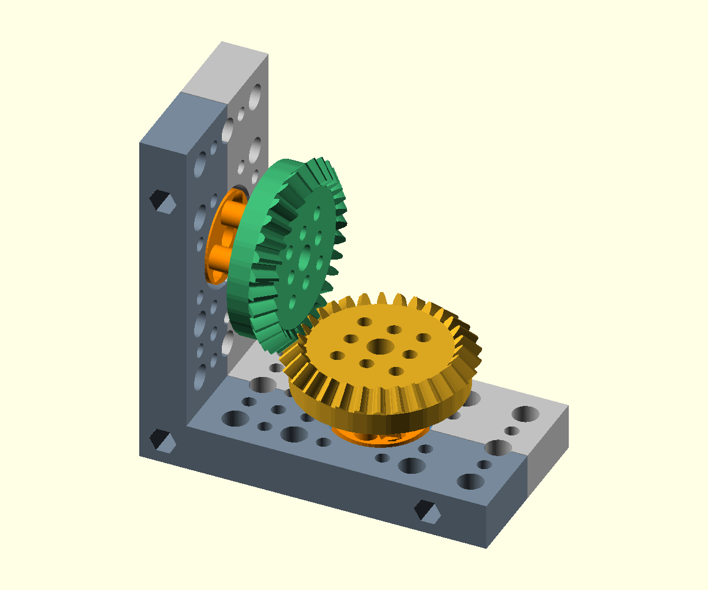

# 6704 corner for the 3-wide bevel gear



This is the smaller version of the [6810 corner](../corner_6810/README.md),
with the same connected corner halves, vertical split, complete hub discs,
extra outward mounting rows and M3×25 socket-cap corner connections.

Two **6704 bearings, 20 × 27 × 4 mm**, support two identical big-scale,
**3-wide / 30-tooth / module-1.5 bevel gears**, turning through 90° at 1:1.
The exact companion is:

`oobb_part_gear_big_scale_3_diameter_30_teeth_bevel_style_12_mm_depth`

The bearings sit 45 mm behind the common axis intersection. The measured gear
centre-to-apex distance is 23.3563 mm; integral stand-offs are 9.6437 mm long.
The second gear and its hub have a 6° half-tooth phase and rotate in the
opposite direction to the first.

## Bearing and gear interfaces

The interiors reuse the regular 6704 holder's complete fitting grid, centre
M6 bore and complementary diagonal countersunk hub joins. This corner uses
the nominal **4 mm bearing width** in its hub profile; the older flat holder's
default print allowance is 3.6 mm. The outer bearing seat is 27.3 mm diameter
and 4.2 mm deep. Hub lips are 22.7 mm diameter; the stationary opening is
25.25 mm, leaving the hubs free to rotate.

Four **M3 holes at (±7.5, 0) and (0, ±7.5) mm** connect each gear to its hub.
Those holes already exist in both the regular 6704 interior and the 3-wide
bevel gear. The M6 corners used on the 6810 version would not fit this bearing.
The four smaller stand-offs include relief for the nearby diagonal hub joins,
so their nut and screwdriver access remains open before the gears are fitted.

The two 12 mm thick arms are 45 mm across. Their full envelope is
**88.5 × 45 × 88.5 mm**. The nominal catalogue size is 5×3×12, allowing an
extra complete **three-hole M6 row at +30 mm** beyond each bearing. The gear
itself is 3 OOBB pitches / 45 mm at its pitch circle.

Both arms carry the complete fitting OOBB pattern: **10 M6 and 17 M3 holes per
arm**, in addition to the already complete regular hub pattern. M6 holes use
the 15 mm grid; M3 holes fill the intervening 7.5 mm positions. Each main-grid
point tries M6 first and M3 if M6 cannot fit. All lattice positions are checked
against the bearing seat, body edges, perpendicular arm and transverse joining
channels, using a 0.3 mm minimum CAD web. Excluded positions and reasons are
recorded under `frame_mounting` in `layout.json`. The screw-access column stays
clear so mounting bores cannot break into the head or nut channels.

Three corner joins use `oobb_screw_socket_cap`, `depth=25`, `nut_include=True`,
`overhang=True`, and `clearance=["top", "bottom"]`, as on the 6810 version.
The primitive supplies the screw bores, head and nut recesses, overhang details
and access channels. The 0.2 mm frame seam is in the vertical Y=0 plane.

## Print and assemble

The print files are in
[`parts/oobb_part_holder_90_degree_bearing_6704_bearing_size_5_width_3_height_12_depth_corner_bevel_30_teeth`](../../parts/oobb_part_holder_90_degree_bearing_6704_bearing_size_5_width_3_height_12_depth_corner_bevel_30_teeth).

| File | Pieces |
| --- | --- |
| `3dpr.stl` | Complete six-piece layout, approximately 194 × 161 × 22.4 mm |
| `print_frame_negative.stl` | One connected corner half |
| `print_frame_positive.stl` | Other connected corner half |
| `print_hub_outer.stl` | Two whole outer hub discs |
| `print_hub_gear.stl` | Two whole gear-facing hub discs with stand-offs |

Every piece starts at Z=0. Each corner half has an 88.5 × 88.5 mm footprint
and is 22.4 mm high; each hub is 22.7 mm across. Use the supplied orientation.
The gear-facing disc prints with its split face down and stand-offs up; use
local support beneath its **1.35 mm radial lip** if needed. The corner saddles
open upward. `components/*.stl` are assembly-coordinate assets, not print files.

Suggested hardware:

- Two 6704 bearings and two matching 30-tooth bevel gears.
- Three M3×25 socket-cap screws and nuts for the corner seam.
- Four M3×12 countersunk screws and nuts for the regular hub joins.
- Eight M3×40 screws, washers and nuts for the gear-to-hub connections.

Sandwich each bearing's inner race between its two hub discs and secure the
diagonal hub joins. Fit both bearing assemblies between the connected corner
halves, then install the three M3×25 seam screws. Bolt the gears through the
four cardinal M3 holes and rotate the second gear and hub together to mesh.
Check free rotation before mounting the frame through its outward rows.
Physical print fit and load testing remain pending.

## Examples and regeneration

- [Assembly](assembly.scad) and [exploded view](exploded.scad).
- [Meshing pair](bevel_mesh.scad): enable **View → Animate** in OpenSCAD.
- [Animated preview](bevel_motion.gif).
- [Print layout](print_layout.scad).
- [Measured layout](layout.json) and [validation report](validation.json).

```powershell
python action_make_corner.py --bearing 6704
python validate_corner.py --bearing 6704
python action_make_corner_animation.py --bearing 6704
python -m pytest tests/test_corner.py -q
```

Both the build and validator also accept `--bearing all`; omitting the argument
keeps the existing 6810 default. Dimensions, hole pattern, pad radius and gear
choice are separate catalogue parameters, rather than a scale applied to the
bearing or fasteners.

Validation checks six connected, watertight printable pieces on the bed;
matching print and assembly volume; the copied hub against a complete regular
holder drawn with the same nominal bearing dimensions; the gear against its
sibling export; 16 positions per tooth cycle; and 64 positions across a full
revolution. Independent OpenSCAD intersection checks cover both assembly and
exploded views. These checks establish sampled CAD clearance.
Bolt-sized cylinder gauges also verify that every planned M6/M3 hole is open
through both arms, including the mirrored arm.
