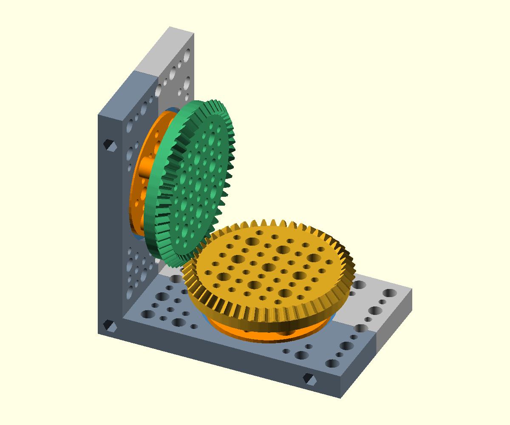

# Two 6810 bearings and a 90° bevel pair



The new catalogue option is `corner_bevel_50_teeth`, under `holder_90_degree`.
It follows `working_populate.py` → OOMP `parts_source/working.yaml` →
`parts/working.yaml` → `working_scad.get_bearing_holder_corner`.
The drawing composes OOBB cube, cylinder, hole and nut primitives in
`working_corner.py`; the bevel teeth come from the sibling gear generator.
This is a new corner family; the existing flat and single-bearing angled
holders keep their own drawings.

## Geometry and gear compatibility

Two nominal **6810, 50 × 65 × 7 mm** bearings have perpendicular X and Z axes.
Their axes meet at the origin. Each bearing centre is **60 mm** behind that
intersection along its own axis. The stationary body is 12 mm thick on each
arm and 75 mm across. Its bounding box is **118.5 × 75 × 118.5 mm**.

Each stationary half is one continuous corner, retaining both outer races.
The body splits through the vertical **Y=0 plane**, with a 0.2 mm assembly
gap. It does not separate into two independent bearing plates. Three recessed
M3×25 socket-cap joins connect the halves. They use `oobb_screw_socket_cap`
with `nut_include=True`, `overhang=True` and `clearance=["top", "bottom"]`.
The primitive supplies the screw bore, socket recess, captive nut, printable
overhang details and access clearance at both ends. Mounting holes use the 15 mm M6 grid, including a complete **five-hole
row at +45 mm** past each bearing, and additional fitting perimeter holes.

Both arms have the complete fitting OOBB pattern: **14 M6 and 25 M3 holes per
arm**, plus the already complete regular hub pattern. M6 uses the 15 mm grid;
M3 fills the intervening 7.5 mm positions. Main-grid positions try M6 first,
then M3 if necessary. Every lattice point is checked against the bearing seat,
body edges, perpendicular arm and transverse screw-access channels, leaving
a 0.3 mm minimum CAD web. The access-channel column is reserved for the joining
screws. `frame_mounting` in `layout.json` records both fitted holes and reasons
for omitted positions.

The companion gears are two identical:

`oobb_part_gear_big_scale_5_diameter_50_teeth_bevel_style_12_mm_depth`

They are module 1.5, 50 teeth, 12 mm deep, 6 mm face width, backlash 0.2 mm,
straight 1:1 mitre gears. Each bolts to four M6 holes at **(±15, ±15) mm** on
the bearing hub. The 40-tooth part does not contain those M6 corner holes.
The build reads and checks the matching gear record in
`../oomlout_oobb_gear_version_5/parts`, then calls that repository's OOBB bevel
drawing. The local gear mesh is checked against the sibling's exported STL.

The gear primitive's actual BOSL2 tooth bounds give a centre-to-pitch-apex
distance of **38.2872 mm**. Both pitch apexes coincide at the origin. Integral
hub stand-offs are **9.7128 mm** long, putting each gear back face at the
required position. Gear B has a **3.6° half-tooth phase**, with the opposite
rotation to gear A. Its hub rotates with it, keeping the bolt patterns aligned.

The bearing outer seat is 65.3 mm diameter × 7.2 mm axial depth. Both interiors
are copied directly from the **regular 6810 holder**, through the same shared
drawing functions: the 50 mm spigot, 56.7 mm lips, centre M6 bore, complete fitting
M6/M3 grid and complementary diagonal countersunk hub joins are retained.
The stationary opening is 61.4 mm diameter, leaving the moving hubs clear.
The frame's shoulders retain the outer race independently. Gear stand-offs
extend the copied gear-facing half; their M6 bores continue the existing holes.

## Print files

The printable files are in:

[`parts/oobb_part_holder_90_degree_bearing_6810_bearing_size_7_width_5_height_12_depth_corner_bevel_50_teeth`](../../parts/oobb_part_holder_90_degree_bearing_6810_bearing_size_7_width_5_height_12_depth_corner_bevel_50_teeth)

| File | Contents | Orientation |
| --- | --- | --- |
| `print_frame_negative.stl` | One connected corner half | Broad outside face on bed, saddle openings up |
| `print_frame_positive.stl` | Other connected corner half | Broad outside face on bed, saddle openings up |
| `print_hub_outer.stl` | Two complete outer hub discs | Outside faces on bed, spigots up |
| `print_hub_gear.stl` | Two complete gear-facing hub discs | Split faces on bed, four stand-offs up |
| `3dpr.stl` | All six printable pieces | Already arranged at Z=0 |

Each corner half fits a **118.5 × 118.5 mm** footprint and is **37.4 mm** high.
Each hub is 56.7 mm across. The complete layout spans approximately
**290 × 223 mm**, so use the separate files for a typical 220 mm bed. Slicers
may centre each file horizontally; preserve its supplied Z orientation.
The hub files already contain the required two copies each.

The gear-facing disc has the regular interior's **3.35 mm radial lip overhang**
above its spigot. Use local support under that lip in the supplied orientation.
The corner saddles open upward, avoiding a roof across the 65 mm seats.
Use several perimeters around the M6 holes and stand-offs. Fit clearances are
parameters; the design has not yet been physically printed or load tested.

`components/*.stl` are in **assembly coordinates**, for the examples and
validation. Use the `print_*.stl` files for printing. Print two companion gears
with their flat backs on the bed, using the gear project's print instructions.

## Assembly

Suggested hardware: two 6810 bearings, two matching bevel gears, three M3×25
socket-head bolts and three M3 nuts for the corner seam, four M3×12 countersunk
bolts and four M3 nuts for the copied regular hub joins, and eight M6×45 bolts with washers and
nuts for the gears. Check actual bolt protrusion and head/nut dimensions against
your hardware before tightening; hardware solids are not included in the CAD
collision report.

1. Fit one outer hub disc into each bearing. Add its gear-facing disc from the
   opposite side, with the stand-offs facing the gears. Join each hub with two
   M3 screws in the off-grid diagonal holes, seating the nuts and heads flush.
2. Place the two bearing/hub units into one connected corner half. Fit the
   other corner half and insert the three recessed M3 seam bolts and nuts.
   The hex access channels load from one broad side; the screw heads and
   screwdriver approach from the other.
3. Bolt each gear through the four stand-offs and the M6 hub corners. Rotate
   the second **hub and gear together** to mesh its teeth with the first.
   The example shows the half-tooth phase; no fixed phase relative to the frame
   is required, because both inner hubs rotate freely.
4. Check free rotation before attaching the frame to its outer mounting rows.
   The exposed M6 mounting holes remain clear of the moving gears.

## Examples and checks

- [Assembled](assembly.scad): frame, both bearings, inner hubs and meshing gears.
- [Exploded](exploded.scad): separates the frame and axial bearing stacks.
- [Meshing pair](bevel_mesh.scad): isolates the gears; enable **View → Animate**
  in OpenSCAD to see the input and output turn on perpendicular axes.
- [Animated preview](bevel_motion.gif): 24 rendered frames of the actual STL pair.
- [Print layout](print_layout.scad): all six printable pieces.
- [Measured layout](layout.json): dimensions, exact companion ID and source.
- [Validation report](validation.json): checks on the rendered solid meshes.

In `assembly.scad`, set `check=1` for gear/gear intersection, `2` for
frame/rotors, `3` for bearing/printed parts, `4` for the corner halves, or `5`
for the complete rotating assemblies against each other.
An empty intersection is the expected result. `angle` can be changed manually.
The shown bearing ring is a nominal clearance solid, not an internal race/ball
model.

Regenerate from the repository root:

```powershell
python action_make_corner.py
python validate_corner.py
python -m pytest tests/test_corner.py -q
python action_make_corner_animation.py  # optional GIF preview
```

The validator checks watertight, connected component meshes; six print pieces
all beginning at Z=0; matching print and assembly volumes; actual gear mesh
compatibility; 16 positions through one 7.2° tooth cycle; and 64 positions across
a complete revolution for the frame, bearings and both rotating assemblies.
Independent OpenSCAD checks exercise the delivered example's own transforms.
Bolt-sized cylinder gauges check that every M6/M3 mounting bore is open through
both arms, including the mirrored arm.
The copied outer hub is also compared as a rendered solid against an interior
isolated from the complete regular 6810 holder. The same race profile, mounting
grid and joining features must match in both directions.
These establish sampled CAD clearance, rather than printed tolerances,
strength, wear or under-load behaviour.

## Adding another bearing later

Copy the corner option block in `working_populate.py`, give it a new
`bearing_size` and `extra`, and change the nested `corner` dimensions. Nominal
inner/outer diameters and bearing depth are explicit, so no 6810-specific
geometry branch is required. Adjust grid width/height, `mounting_row`, fit
clearances and the companion gear parameters as needed. Each option can remain
independently editable.

The shared layout computes race lips, gear stand-off height, an OOBB-grid-snapped
axis setback and print spacing. It rejects seats too big for the body, invalid
depths, mounting rows crossing the bearing, and gears or bearing bores too small
for the current M6 corner interface. Smaller bearings will need a smaller
gear/hub bolt pattern as a separate interface extension; changing the bearing
name alone cannot make those four M6 corners fit.
